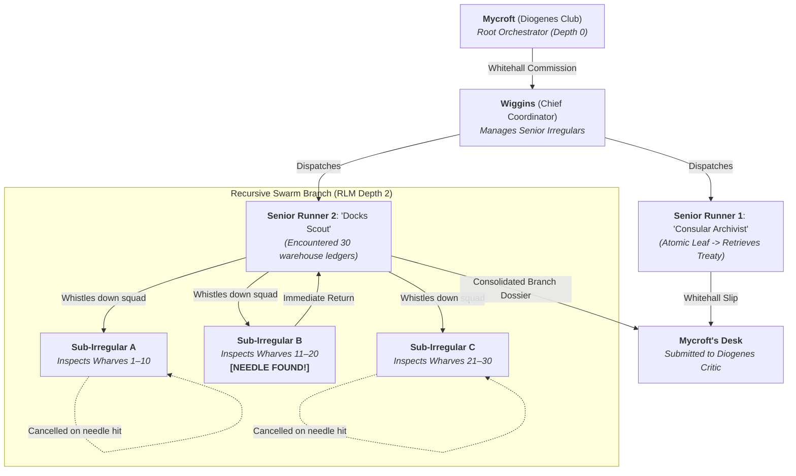

# RLM — The Baker Street Swarm & Branching Protocol

When an enquiry faces a vast corpus, high-dimensional hypothesis space, or wide directory/ledger tree, Mycroft engages the **Baker Street Swarm Protocol**.

Rather than dispatching an individual runner to execute a slow, linear crawl that exhausts token limits, Mycroft commissions **Wiggins** (Chief Coordinator), who deploys a tree of **Senior Irregulars** and allows them to branch into **Sub-Irregulars** when depth demands it.

---

## 1. Architecture of the Branching Swarm

### The Branching Workflow
1. **The Senior Commission**:
   Mycroft hands Wiggins a formal Whitehall Commission Slip specifying:
   - Target entity / question / corpus.
   - Irreducible primitive and acceptance check.
   - Resource ceilings and time budget.
2. **Terrain Assessment**:
   The Senior Runner assesses the assigned territory. If the volume exceeds a single bounded context (e.g. dozens of files or tables), the Senior Runner acts as a **Branch Coordinator (Junior Wiggins)**.
3. **Sub-Irregular Fan-Out**:
   The Senior Runner partitions the search space into disjoint slices and recruits 2–4 Sub-Irregulars (leaf micro-agents).
4. **Early Termination on Needle Hit**:
   As soon as any Sub-Irregular secures the definitive fact or counterexample, the branch halts immediately. Sibling tasks are short-circuited.
5. **Upward Aggregation**:
   Sub-Irregulars deliver atomic excerpts and locators back to their branch parent. The Senior Runner joins the data, strips the noise, and presents a single consolidated slip up to Wiggins and Mycroft.

---

## 2. The 4 Iron Invariants of Branching Swarms

A swarm without halting invariants degrades into exponential token consumption ($O(\text{fanout}^\text{depth})$). Every Baker Street Swarm strictly enforces:

| Invariant | Rule | Action on Trigger |
|:---|:---|:---|
| **Depth Ceiling** | Maximum recursion depth is **2** by default (hard cap: **3**). | Sub-Irregulars at Depth 2 are strictly leaf workers and **forbidden** from spawning further children. |
| **Fan-Out Budget** | Maximum **3 to 6** parallel Sub-Irregulars per branch. | Prevent runaway spawning; partition search space into bounded batches. |
| **Early Needle Hit** | Immediate short-circuit on definitive ground truth. | Cancel or early-exit all pending sibling branch calls. |
| **Upward Consolidation** | Sub-lads report *only* to their branch parent. | The senior runner deduplicates, validates line spans, and submits one unified Whitehall slip. |

---

## 3. The Aggregation Contract

Leaf Sub-Irregulars never converse directly with Mycroft. They deliver atomic findings to their Branch Coordinator:
1. **Source Locators:** Exact file paths, line numbers, or API endpoints.
2. **Direct Excerpts:** Unmodified text, exact code fragments, or raw measurements.
3. **Uncovered Scope:** Explicitly stating what was *not* checked on this branch.

The Senior Runner joins the returns, resolves discrepancies, filters out noise, and delivers a hardened, source-backed Whitehall slip to Mycroft at the Diogenes Club.
