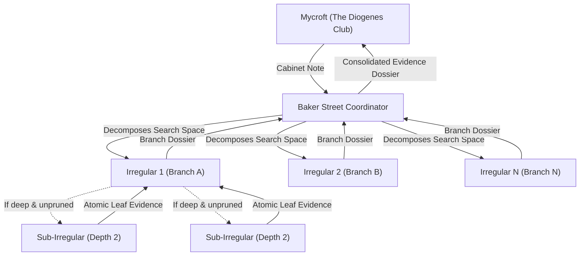

# RLM — The Baker Street Swarm Protocol

When an enquiry faces a vast corpus, high-dimensional hypothesis space, or complex combinatorial structure, Mycroft engages the **Baker Street Swarm Protocol**.

Rather than dispatching a single researcher to execute a slow, linear crawl, Mycroft commissions **The Baker Street Coordinator**, who deploys a recursive swarm of **Baker Street Irregulars** to canvass the territory.

---

## 1. Architecture of the Swarm

1. **The Cabinet Commission:**
   Mycroft writes a specific commission slip to the Baker Street Coordinator specifying:
   - Target entity / question / corpus.
   - Decomposition strategy (file-by-file, hypothesis-by-hypothesis, or parameter slices).
   - Hard halting conditions and resource ceilings.
2. **Dynamic Fan-Out:**
   The Baker Street Coordinator breaks down the problem and spawns Irregulars in parallel (`invoke_subagent` or local micro-agent calls).
3. **Recursive Depth:**
   An Irregular exploring a dense sub-branch may spawn depth-2 sub-irregulars if the branch remains too wide for a single prompt context.

---

## 2. Hard Stopping Conditions & Convergence Rules

A swarm without halting invariants degrades into unbounded token consumption. Every Baker Street Swarm must enforce the following four stopping conditions:

| Condition | Invariant Rule | Action on Trigger |
|:---|:---|:---|
| **Depth Ceiling** | Maximum recursion depth is **2** by default (hard cap: **3**). | Prevent further child spawns; force leaf analysis and return. |
| **Fan-Out Cap** | Maximum **3 to 8** parallel Irregulars per node. | Queue or prune lower-priority branches via JEV. |
| **Definitive Needle Found** | The falsifying counterexample or target locator is identified. | Immediate short-circuit return; cancel pending sibling branches. |
| **Iteration & Work Limit** | Bounded budget of total subagent calls or execution time. | Stop exploration, aggregate partial findings, and explicitly report uncovered scope. |

---

## 3. The Aggregation Contract

Leaf Irregulars do not speak directly to Mycroft. They return atomic findings to the Baker Street Coordinator:
1. **Source Locators:** Exact file paths, line ranges, commit hashes, or API records.
2. **Direct Excerpts:** Unmodified text, exact code fragments, or raw measurements.
3. **Uncovered Scope:** Explicitly stating what was *not* checked on this branch.

The Baker Street Coordinator joins the returns, resolves discrepancies, filters out noise, and presents a single, hardened, source-backed dossier to Mycroft at the Diogenes Club.
