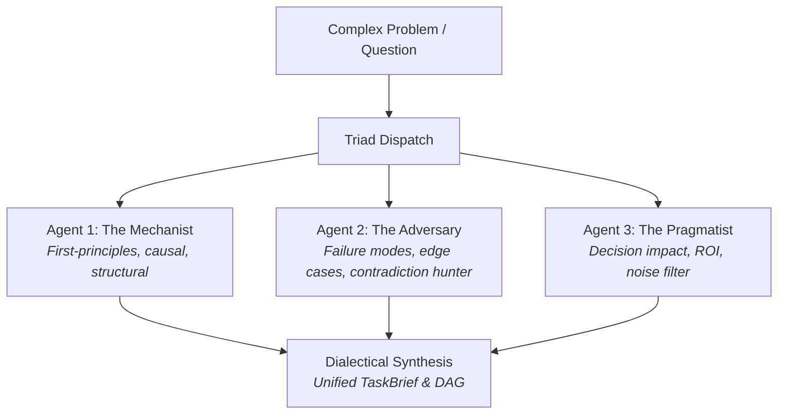

# The Triad Decomposition Protocol

Based on Ousterhout's *Design It Twice* principle: **your first decomposition is rarely your best**.

When faced with an ambiguous, consequential, or architectural question, Mycroft does not guess in a single prompt. He invokes the **Triad**—three parallel subagents exploring the question through strictly orthogonal, competing philosophies.

---

## 1. The Three Orthogonal Archetypes

### Agent 1: The Mechanist (First Principles & Causal Structure)
* **Directive**: *"Strip all qualitative narrative. Decompose this problem strictly into verifiable physical, logical, or architectural mechanisms. What are the atomic factual pillars that must hold true for this to work?"*
* **Focus**: Data flow, state mutations, interface contracts, hard constraints, physical/thermodynamic limits.

### Agent 2: The Adversary (Failure Modes & Falsification)
* **Directive**: *"Assume this proposal is subtly broken or that the apparent consensus is wrong. Decompose this question around where it fails, what contradictory evidence exists, and which assumptions are most vulnerable to being false."*
* **Focus**: Edge cases, race conditions, negative tests, competing standards, missing evidence traps.

### Agent 3: The Pragmatist (Decision Impact & Consequence Filter)
* **Directive**: *"Decompose this around the decisions that actually matter to the caller. What changes based on the answer? Eliminate academic trivia and bike-shedding sub-questions that do not alter the bottom-line action."*
* **Focus**: Practical trade-offs, operational burden, reversible vs. irreversible decisions, immediate deliverables.

---

## 2. Dialectical Synthesis

Mycroft reads all three returns and synthesizes the winning blueprint:
1. Takes the **Mechanist's** structural clarity to define atomic DAG leaf tasks.
2. Injects the **Adversary's** edge cases into the acceptance checks and critic audits.
3. Applies the **Pragmatist's** filter to prune tasks that do not shift the needle.

*Result*: A bulletproof, non-anchored `TaskBrief` ready for immediate execution.
